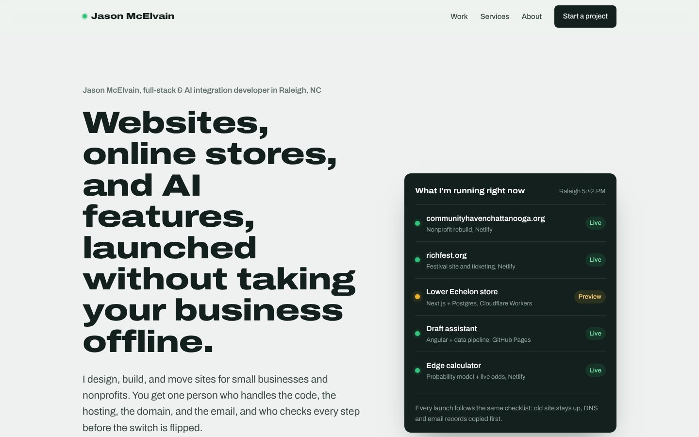

# jasonmcelvain: portfolio site

My freelance portfolio: websites, online stores, and AI features for small businesses and nonprofits, launched without downtime.

**Live site:** https://jasonmcelvain.netlify.app

## What's on it
- **A live status board** in the hero, listing the client sites and apps I'm currently running and where each is hosted
- **Seven case studies:** a custom Next.js + Postgres storefront on Cloudflare Workers, a nonprofit rebuild and host migration, a festival site with ticketing, an AI client-intake assistant, a value-based fantasy draft board, a sports probability model, and an invoicing app with Microsoft sign-in
- **Services, process, and a contact form** handled by Netlify Forms, with a honeypot field for spam

## Built with
Hand-written HTML and CSS in a single page, no framework and no build step. Typography is one variable font (Archivo) used across its width axis: expanded for headlines, normal for reading. Responsive down to 390 px, keyboard-focus visible, and it respects reduced-motion settings.

## Deploy
Deployed on Netlify from this repo's `main` branch: every push redeploys automatically (publish directory: `/`). `netlify.toml` sets long-term caching for images and basic security headers.

Built by [Jason McElvain](https://github.com/MacSupportPlus).
